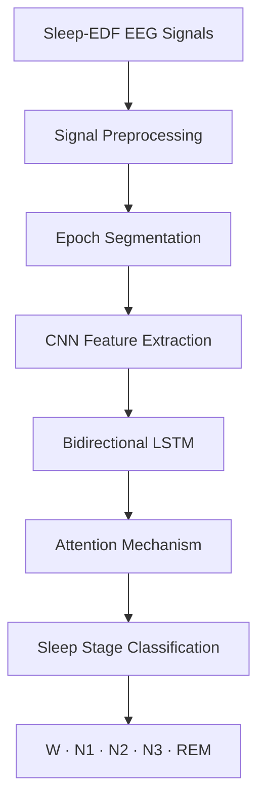

<div align="center">

# 🧠 Sleep Stage Classification Using Deep Learning

### EEG Signal Analysis · CNN + BiLSTM + Attention

**Undergraduate Thesis | Computer Science and Engineering**  
**University of Asia Pacific, Bangladesh**


**Automated classification of five sleep stages from EEG signals using a deep learning approach.**

[Explore the Notebook](./Untitled.ipynb) · [Dataset Information](https://physionet.org/content/sleep-edfx/1.0.0/)

</div>

---

## 📌 Project Overview

Sleep staging is an important part of understanding sleep patterns. This undergraduate research project investigates how **deep learning** can classify sleep stages automatically from **electroencephalogram (EEG) signals**.

The workflow combines EEG preprocessing with a **CNN + Bidirectional LSTM + Attention** model to learn relevant signal features and temporal relationships.

### 🎯 Research Objectives

- Prepare EEG recordings for automated sleep-stage analysis.
- Classify sleep epochs into **Wake (W), N1, N2, N3, and REM**.
- Explore the effectiveness of combining convolutional, recurrent, and attention-based components.
- Evaluate model performance across different sleep stages.

---

## 🏗️ Model Architecture



**Pipeline:** EEG input → preprocessing → segmentation → CNN → BiLSTM → Attention → five-class prediction.

---

## 📊 Dataset and Methodology

| Component | Description |
|:--|:--|
| **Dataset** | Sleep-EDF (PhysioNet) |
| **Input** | EEG recordings |
| **Sampling rate** | 100 Hz |
| **Epoch duration** | 30 seconds |
| **Preprocessing** | Signal segmentation and standardization |
| **Classes** | W, N1, N2, N3, REM |
| **Model** | CNN + BiLSTM + Attention |

> **Note:** The table summarizes the thesis workflow. For implementation details, inspect the notebook and its preprocessing steps.

---

## 📈 Research Results

<div align="center">

### **77.17%**

**Reported overall classification accuracy**

</div>

The model was evaluated on five sleep-stage classes. Performance can vary by class, particularly for stages that are harder to distinguish from EEG signals.

<!-- To display your real results, upload the figures to an images/ folder and remove the comment markers below.
### Confusion Matrix


### Training Curves

-->

---

## 🛠️ Tools and Technologies

- **Language:** Python
- **Environment:** Jupyter Notebook
- **Research areas:** Deep Learning, EEG Signal Processing, Time-Series Classification
- **Model components:** CNN, BiLSTM, Attention

---

## 📁 Repository Contents

```text
Sleep-EDF-Thesis/
├── README.md            # Project overview and documentation
├── Untitled.ipynb        # Thesis research notebook
└── .gitignore            # Git ignore rules
```

> The notebook currently retains its original filename, `Untitled.ipynb`. It can be renamed later to `Sleep_Stage_Classification.ipynb` for clarity; update the link above if you rename it.

---

## 🚀 Explore the Implementation

Open **[the research notebook](./Untitled.ipynb)** to review the code and experimental workflow.

To run the notebook locally, use a compatible Python/Jupyter environment and install the dependencies imported by the notebook. The Sleep-EDF data must be obtained separately from the dataset provider, subject to its terms.

---

## 🔬 Research Interests

This thesis strengthened my interest in **Artificial Intelligence, Data Analytics, and applied research**. I am also interested in exploring how data-driven techniques can support intelligent and user-centred web applications.

---

## 👨‍💻 Author

**Farhan Labib**  
B.Sc. in Computer Science and Engineering  
University of Asia Pacific, Bangladesh

**GitHub:** [@Farhan2580](https://github.com/Farhan2580)

---

<div align="center">

*Developed as part of an undergraduate research thesis.*

</div>
