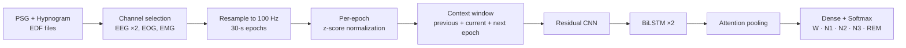
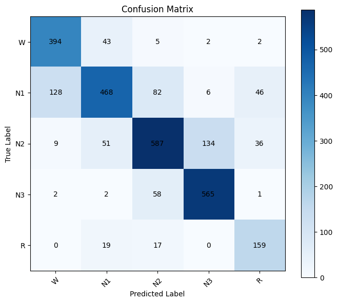
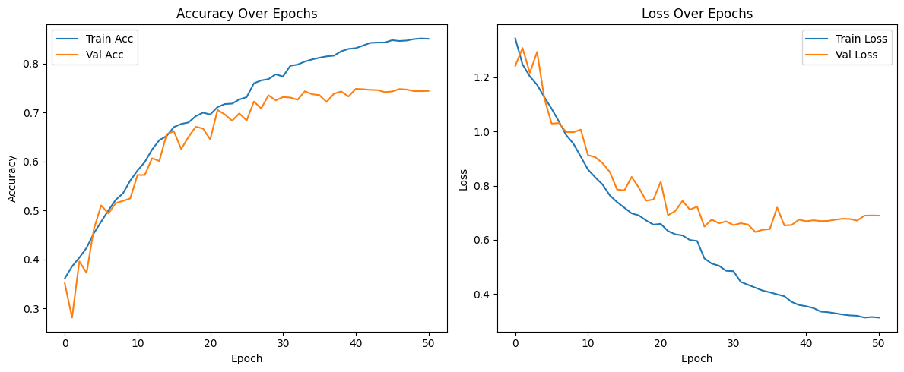

<div align="center">

# 🧠 Sleep Stage Classification Using Deep Learning

### Multi-channel PSG signals · Residual CNN + BiLSTM + Attention

**Undergraduate Thesis · B.Sc. in Computer Science and Engineering**
**University of Asia Pacific, Dhaka, Bangladesh**


**Automatic 5-class sleep staging (W, N1, N2, N3, REM) from EEG, EOG and EMG recordings of the Sleep-EDF Expanded dataset.**

| Test accuracy | Macro F1 | Recordings | 30-s epochs | Parameters |
|:---:|:---:|:---:|:---:|:---:|
| **77.17 %** | **0.768** | 197 | 28,158 | 3.6 M |

[📓 Open the notebook](./Untitled.ipynb) · [📂 Dataset (PhysioNet)](https://physionet.org/content/sleep-edfx/1.0.0/)

</div>

---

## 📌 Overview

Manual sleep staging by experts is slow and subjective. This project builds an end-to-end deep learning pipeline that reads raw polysomnography (PSG) recordings and predicts the sleep stage of each 30-second epoch.

The model combines three ideas:

- **Residual 1D convolutions** learn local waveform features (spindles, K-complexes, slow waves).
- **Bidirectional LSTMs** model how the signal changes over time.
- **Attention pooling** lets the model focus on the most informative parts of each sequence.

---

## 📊 Dataset

| Item | Details |
|:--|:--|
| Source | [Sleep-EDF Database Expanded v1.0.0](https://physionet.org/content/sleep-edfx/1.0.0/) (PhysioNet) |
| Subsets | Sleep Cassette (153 recordings) + Sleep Telemetry (44 recordings) |
| Channels | EEG Fpz-Cz, EEG Pz-Oz, EOG horizontal, EMG submental |
| Sampling rate | 100 Hz |
| Epoch length | 30 seconds |
| Classes | W, N1, N2, N3 (stages 3 and 4 merged, AASM style), REM |
| Total samples | 28,158 epochs |

**Class distribution:** W 4,460 · N1 7,292 · N2 8,171 · N3 6,282 · REM 1,953

---

## ⚙️ Pipeline



1. **Loading:** PSG and hypnogram files are read with MNE-Python, and sleep-stage annotations are mapped to 5 classes.
2. **Normalization:** each epoch is standardized (zero mean, unit variance) to reduce differences between subjects and devices.
3. **Context:** each sample includes its neighbouring epochs (input length 3 × 3,001 = 9,003 time steps). Context never crosses recording boundaries.
4. **Class imbalance:** handled with balanced class weights during training.

---

## 🏗️ Model Architecture

| Block | Configuration |
|:--|:--|
| Input | 9,003 time steps × 4 channels |
| Residual CNN | 3 blocks (128 → 256 → 256 filters, kernel 7), BatchNorm, ReLU, MaxPool, Dropout 0.2 |
| BiLSTM | 2 layers (256 and 128 units per direction) |
| Attention | Additive attention pooling over time |
| Classifier | Dense 256 → Dense 128 (Dropout 0.5) → Softmax (5 classes) |
| Parameters | 3,603,206 |

**Training setup:** Adam (lr = 3e-4), sparse categorical cross-entropy, batch size 32, up to 60 epochs, ReduceLROnPlateau and EarlyStopping (best weights restored from epoch 41). Data split 80 / 10 / 10 (train / validation / test), stratified by class.

---

## 📈 Results

Evaluated on the held-out test set (2,816 epochs):

| Stage | Precision | Recall | F1-score | Support |
|:--|:--:|:--:|:--:|:--:|
| W | 0.739 | 0.883 | 0.805 | 446 |
| N1 | 0.803 | 0.641 | 0.713 | 730 |
| N2 | 0.784 | 0.719 | 0.750 | 817 |
| N3 | 0.799 | 0.900 | 0.846 | 628 |
| REM | 0.652 | 0.815 | 0.724 | 195 |
| **Macro avg** | **0.755** | **0.792** | **0.768** | 2,816 |
| **Overall accuracy** | | | **0.7717** | |

<div align="center">

### Confusion Matrix


### Training Curves


</div>

**Observations**

- **N3 (deep sleep)** and **Wake** are recognized best (F1 0.85 and 0.80).
- **N1** is the hardest stage. It is often confused with Wake and N2, which matches what is reported in the sleep-staging literature.
- Most N2 errors are predicted as N3, since both stages share slow-wave activity.

---

## 🔍 Limitations and Future Work

- The data split is done at the **epoch level**, so epochs from the same recording can appear in both training and test sets. A **subject-wise split** (e.g. leave-subjects-out cross-validation) would give a stricter estimate of how well the model generalizes to new people.
- The gap between training and validation accuracy suggests some overfitting. Stronger regularization or data augmentation could help.
- Next steps: longer context windows, subject-wise cross-validation, and comparison with baselines such as DeepSleepNet and AttnSleep.

---

## 🚀 How to Run

```bash
git clone https://github.com/Farhan2580/Sleep-EDF-Thesis.git
cd Sleep-EDF-Thesis
pip install tensorflow==2.10 mne scikit-learn numpy matplotlib jupyter
jupyter notebook Untitled.ipynb
```

1. Download the [Sleep-EDF Expanded dataset](https://physionet.org/content/sleep-edfx/1.0.0/).
2. Set `BASE_DIR` in the notebook to the folder that contains the dataset.
3. Run the cells in order. A GPU is strongly recommended (one training epoch took about 4 minutes on a GPU).

---

## 📁 Repository Structure

```text
Sleep-EDF-Thesis/
├── Untitled.ipynb            # Full pipeline: loading, preprocessing, model, training, evaluation
├── images/
│   ├── confusion_matrix.png
│   └── training_curves.png
└── README.md
```

---

## 📚 References

- Kemp, B., Zwinderman, A. H., Tuk, B., Kamphuisen, H. A. C., & Oberyé, J. J. L. (2000). Analysis of a sleep-dependent neuronal feedback loop: the slow-wave microcontinuity of the EEG. *IEEE Transactions on Biomedical Engineering*, 47(9), 1185–1194.
- Goldberger, A. L., et al. (2000). PhysioBank, PhysioToolkit, and PhysioNet. *Circulation*, 101(23), e215–e220.

---

<div align="center">

**Farhan Labib** · B.Sc. in Computer Science and Engineering, University of Asia Pacific

</div>
